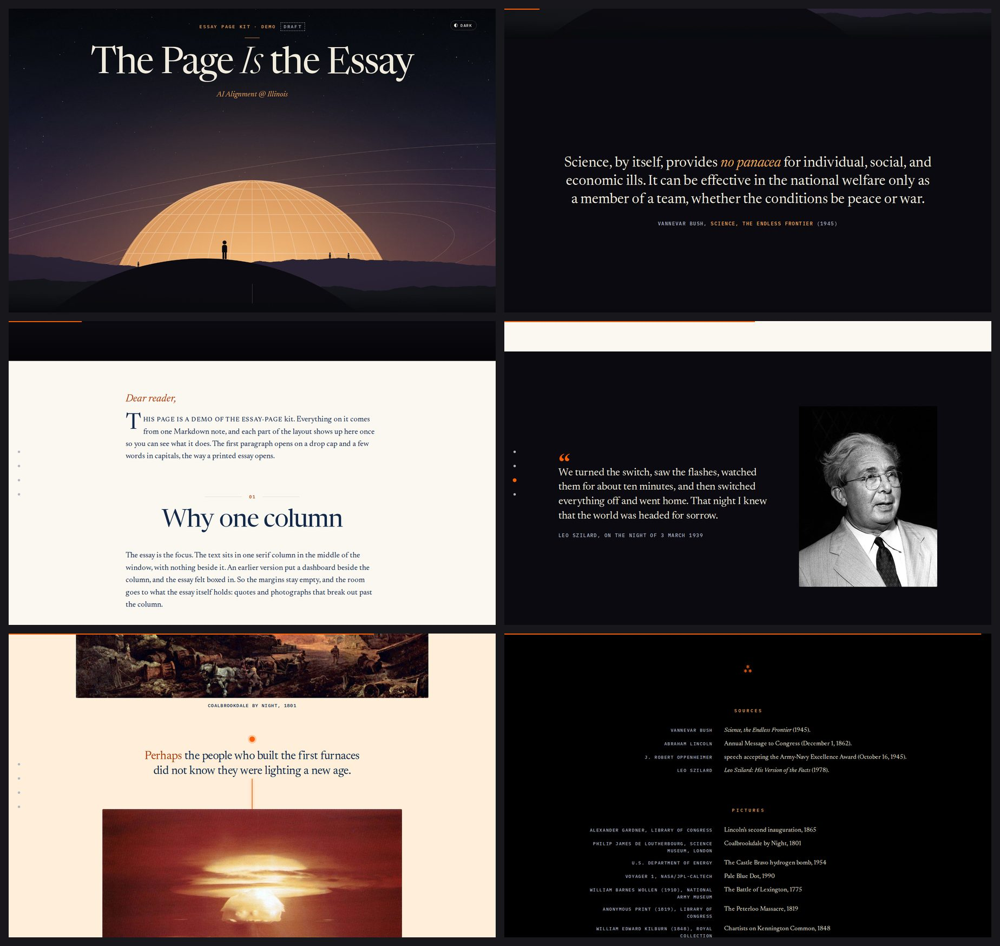
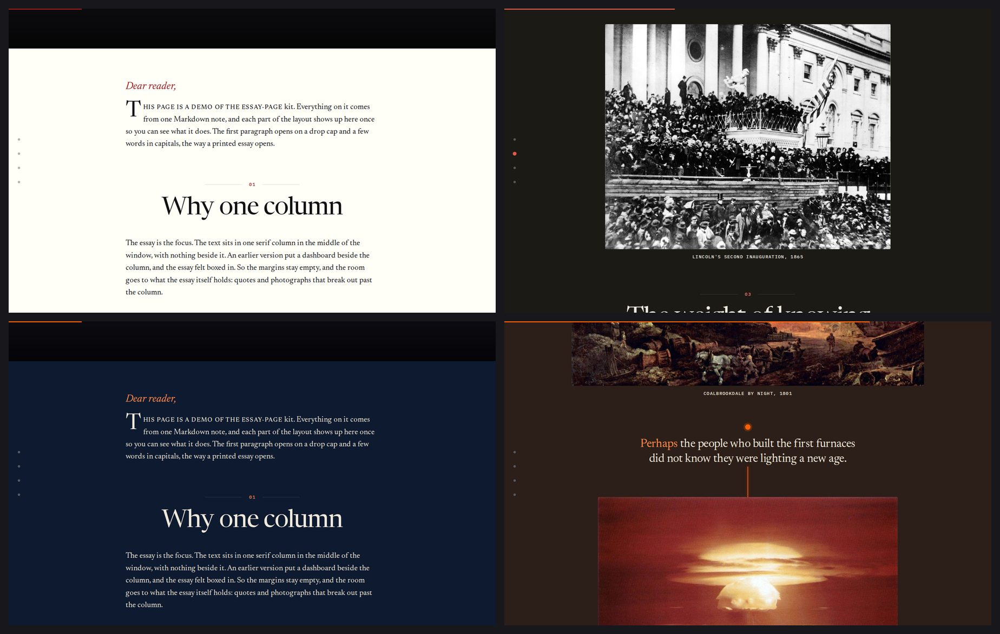
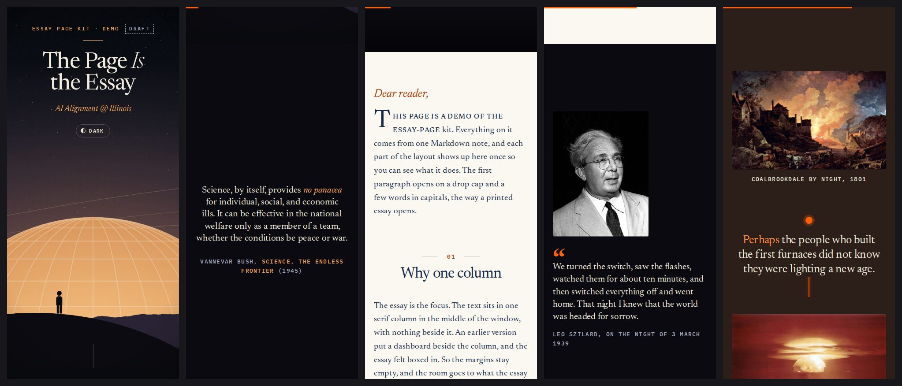

# essay-page

A Claude Code skill and design set for long-form essay pages on the web: open letters, essays,
newsletter lead pieces. You keep writing in a Markdown note, and the page renders from it.

The look comes from the October 2026 exec letter of AI Alignment @ Illinois. One centred serif
column on warm paper with nothing beside it. Quotes and photographs break out past the column. The
page opens on a night title card and ends in black, with the sources rolling as film credits. The
paper takes a light tint per passage, and the heaviest passage goes dark from edge to edge. Words
ink in as you reach them and quotes light up as you scroll. One dial turns all motion down.

Here is the demo essay in this repo, built by the skill:



The `plain` palette in light and dark (top), and the club palette in dark mode (bottom):



On a phone:



## What is in it

- **A design set.** Tokens for colour roles, type, layout widths, vertical rhythm and motion in one
  file (`essay-tokens.css`), with two palettes (`illinois`, the club's navy and orange, and `plain`)
  in light and dark. Component CSS that uses only tokens. A motion script with no framework in it.
  Every value and component is documented in `references/design-system.md`.
- **A Next.js kit.** An `<Essay>` component that renders the note's JSON and a per-essay config:
  where each picture goes, which quotes get a portrait, how each passage should feel.
- **Scripts.** Set up a new essay, sync the note, size pictures, check the config against the text,
  screenshot the page at desktop and phone widths, render a title card.
- **The rules behind it.** Why the column has nothing beside it, why pictures carry no effects, why a
  face beside a quote must be its author, and the rest. Each comes from a version of the page that
  was tried and rejected (`references/history.md`).
- **Optional views and comments,** stored in Turso over HTTP.

## Guide

### 1. Install

You need [Claude Code](https://docs.claude.com/en/docs/claude-code), Python 3.9 or newer, Node 20 or
newer, and a Next.js App Router site (the kit is tested on Next.js 16 with React 19).

```bash
git clone https://github.com/AI-Alignment-UIUC/essay-page ~/.claude/skills/essay-page
pip install markdown-it-py pillow numpy
```

For screenshots, add Playwright to the site once:

```bash
npm i -D playwright-core && npx playwright install chromium
```

Start a new Claude Code session and ask "what skills do you have?" to see `essay-page` in the
list. To update later: `git -C ~/.claude/skills/essay-page pull`.

Optional: title cards are drawn with the
[cinematic-slides](https://github.com/AI-Alignment-UIUC/cinematic-slides) skill. Install it the same
way if you want a drawn title card. Without it the page draws a night sky in CSS.

### 2. Write the essay as a Markdown note

Any editor works (Obsidian, VS Code, a plain text file). The file name becomes the title.

```markdown
> An opening quote goes above the first heading.
>
> Its Author, *Its Source* (1945)

## Intro

Dear reader,

The first paragraph gets a drop cap.

## A section title

Paragraphs, *italics* and [links](https://example.org) work.

> A quote with an attribution.
>
> The Speaker, where they said it (1939)

## What you can do

1) Stuck? A numbered list becomes recommendations, two across.
2) Be specific - a short label before " - " or "?" is set in bold.

## Close

The ending has no title on the page.

## Sources

- Author, *Work* (year).

## Notes

Anything here and below stays off the page.
```

The full format is in `references/content.md`. `assets/example/The Page Is the Essay.md` is a
complete example that uses every part.

### 3. Ask Claude Code for the page

Open Claude Code in your site's repo and ask in plain words:

> Put my essay `notes/On Taking It Seriously.md` on our site as a letter page, in the style of the
> club letter. Don't publish it, just show me.

Claude reads the essay and proposes a plan: a mood for each section, pictures for the points that
need them, which quotes get the speaker's portrait, which numbers get marked. Say what you want
changed. Then it:

1. sets the essay up in the repo with its publish switch off;
2. finds public domain or openly licensed pictures and checks each licence;
3. builds the page, screenshots it at desktop and phone widths in light and dark, and fixes what
   looks wrong;
4. gives you a local link, and an unlisted link if you want to share the draft.

Ask for changes the way you would ask a designer: "the portraits are too small", "use a picture from
the American Revolution here", "this caption is too long", "less motion". Your words in the note are
never changed on the page; ask Claude to edit the note if you want a fix.

### 4. Or set it up by hand

```bash
cd your-site
python3 ~/.claude/skills/essay-page/scripts/init_essay.py --repo . --slug on-taking-it-seriously \
  --title "On Taking It Seriously" --note "notes/On Taking It Seriously.md"
npx next dev
# open http://localhost:3000/essays/on-taking-it-seriously
```

`init_essay.py` copies the design set into the repo (it never overwrites a file you changed), adds
the route `app/essays/<slug>/`, an unlisted copy at a random path, a starter config, and syncs the
note. Then:

| To | Do |
|---|---|
| Update the text after editing the note | `python3 -I scripts/sync_essay.py "<note>.md" content/essays/<slug>.json` |
| Set the kicker, byline, moods, marked numbers | Edit `content/essays/<slug>.config.json` (every field: `references/content.md`) |
| Add a picture | Put the file in `public/essays/<slug>/` (size it with `scripts/photos.py`), add it to `figures`, `strips` or `faces` in the config |
| Check the config against the text | `python3 ~/.claude/skills/essay-page/scripts/check_essay.py content/essays/<slug>.json content/essays/<slug>.config.json public/essays/<slug>` |
| See it at phone and desktop widths | `node ~/.claude/skills/essay-page/scripts/shoot.mjs http://localhost:3000/essays/<slug> shots` |
| Turn motion down | Add `?loud=0.4` (or `?loud=0` for none) to the address |
| Switch to the neutral look | `"palette": "plain"` in the config. Mood tints follow the palette |
| Publish | Set `PUBLISHED = true` in `app/essays/<slug>/page.tsx`, delete the unlisted folder, deploy |

If your site has a sticky header, add `data-essay-masthead` to it and set `--lt-headh` to its height
in `app/essay-tokens.css`. The title card then clears it, and the header slides away while reading.

### 5. Share a draft

While `PUBLISHED` is false, the essay's main address returns 404 on your live site. The unlisted copy
(`/essays/<slug>/<random>`) is live, hidden from search engines and linked from nowhere. Deploy and
send that link. `references/publishing.md` has the deploy commands, the checks to run after, and a
tunnel recipe for showing a local build without deploying.

### 6. Make it your own

- **Your colours:** copy a palette block in `app/essay-tokens.css`, change the values (the colour
  roles and the six mood tints, light and dark), and set `palette` in the config. Then run
  `node ~/.claude/skills/essay-page/scripts/check_contrast.mjs app/essay-tokens.css app/essay.css`:
  it checks every text colour on the paper, each tint and the night, and must end `all pass`.
- **One essay's tweaks:** `tokens` and `tokensDark` in its config.
- **Another framework:** the design set is `essay-tokens.css`, `essay.css`, `lib/essay/motion.ts`
  and the markup in `references/design-system.md` section 7. Render that markup from the same JSON
  in Astro, Eleventy or plain HTML and call `startEssayMotion(root)`.
- **Views and comments:** run `init_essay.py` with `--talk`, then see `references/publishing.md`
  section 6.

### 7. For AI Alignment @ Illinois writers

Club letters use the `illinois` palette and the drawn title card, and live on the club site as
essays. Write in your own note, then ask Claude Code in the site repo for "a letter page for my
note, like the October letter". Keep the draft unlisted until the exec team has read it.

## Troubleshooting

| Problem | Fix |
|---|---|
| The page is 404 on a production build | Expected while `PUBLISHED` is false. To see the draft in a production build, build and start with `VERCEL_ENV=preview` |
| A picture disappeared after editing the essay | Its `at` phrase is no longer in the text. Run `check_essay.py` and pick a new phrase |
| A note to self shows on the page | Put it after ` ## ` at the end of the line, or under `## Notes` |
| A list shows as one paragraph | Obsidian tab-indented lists: put a blank line before the list and start items at the margin |
| Words never appear | The motion script failed; they appear after 4 s anyway. Check the browser console |
| `ModuleNotFoundError: markdown_it` | `pip install markdown-it-py` for the Python you run the sync with |

## Check the skill

```bash
bash ~/.claude/skills/essay-page/scripts/selftest.sh /tmp/essay-selftest
```

It builds the demo in a fresh Next.js app and must end `selftest: ok`.

## Licence

MIT. The demo's pictures are public domain, and their makers are listed in the demo's credits. The
title card art is the club's own.
